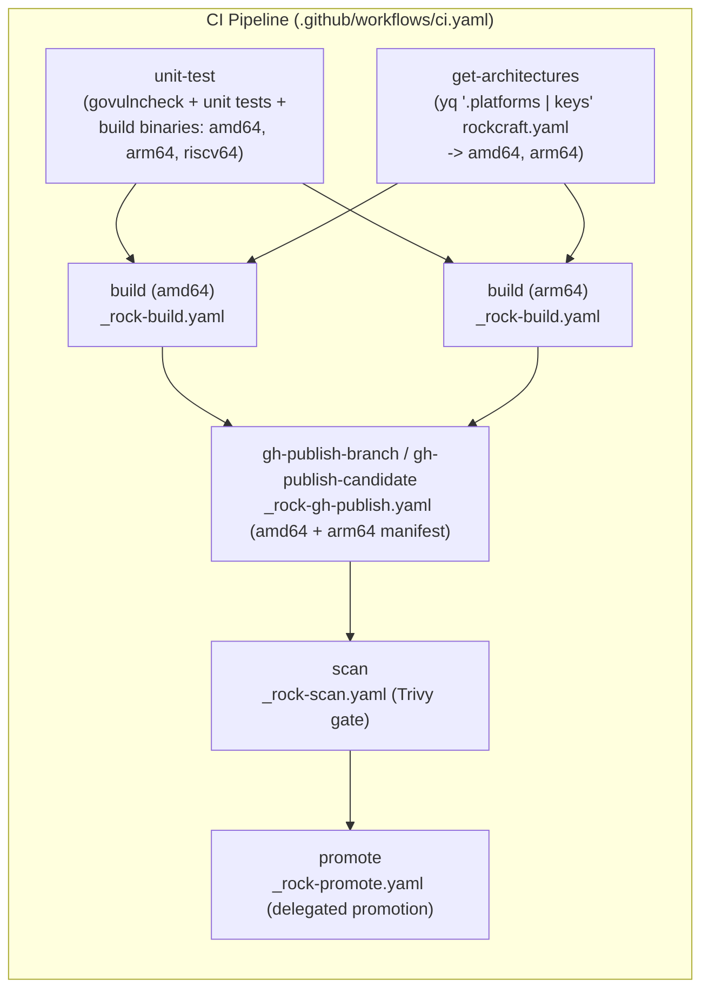

# Design

## Context

See `proposal.md` for motivation. Five repository and pipeline constraints currently limit `authorization-service` to `amd64`:

1. `scripts/build-app.sh` hardcodes `GOARCH=amd64` on the `go build` command line, preventing `arm64` and `riscv64` binary builds.
2. `rockcraft.yaml` declares only `platforms.amd64` and does not export `GOARCH="${CRAFT_ARCH_BUILD_FOR}"` in `parts.go-build.override-build`.
3. `build.sh` hardcodes `authorization-service_${VERSION}_amd64.rock`, and `skaffold.yaml` lists only `linux/amd64`.
4. `.github/workflows/ci.yaml` runs a single `build` job and passes `rock: ${{ needs.build.outputs.rock }}` to `_rock-gh-publish.yaml`, which forces single-architecture publishing.
5. `canonical/identity-team/.github/workflows/_rock-promote.yaml` runs `skopeo copy` without `--all`, which copies only the `amd64` manifest when promoting a multi-architecture candidate image.

## Goals / Non-Goals

**Goals:**
- Build static Go binaries (`CGO_ENABLED=0`) for all three architectures: `linux/amd64`, `linux/arm64`, and `linux/riscv64`.
- Build, test, scan, and publish native Rock and container images only for the supported image architectures: `amd64` and `arm64`.
- Preserve both `amd64` and `arm64` manifests when promoting release candidates to `stable` and `<version>`.

**Non-Goals:**
- Building, testing, or publishing Rock or Docker container images for `riscv64`.
- Changing runtime application configuration or database schemas (no database changes apply).

## Decisions

### 1. Build Binaries for `amd64`, `arm64`, and `riscv64` via `scripts/build-app.sh` and `Makefile`
- **Decision**: Update `scripts/build-app.sh` to resolve `GOOS=${GOOS:-$(go env GOOS)}`, `GOARCH=${GOARCH:-$(go env GOARCH)}`, and `APP_BINARY_PATH=${APP_BINARY_PATH:-bin/app}` so `make build` is host-relative while `rockcraft.yaml` exports `GOARCH="${CRAFT_ARCH_BUILD_FOR}"` as the single source of truth for Rock builds. Add a `build-all` target in `Makefile` that runs `scripts/build-app.sh` for `linux/amd64`, `linux/arm64`, and `linux/riscv64` (producing `bin/app-linux-amd64`, `bin/app-linux-arm64`, and `bin/app-linux-riscv64`) and execute `make build-all` plus `file` ELF architecture assertions (`x86-64`, `aarch64`, `RISC-V`) in `.github/workflows/unittest.yaml`.
- **Rationale**: `CGO_ENABLED=0` compiles `amd64`, `arm64`, and `riscv64` natively with the standard Go toolchain on a single runner. Building and asserting ELF headers for all three binaries during `unit-test` verifies `riscv64` support without running `riscv64` container builds.
- **Alternatives Considered**:
  - *Run three separate GitHub Actions jobs for Go binary compilation*: Rejected because Go cross-compilation with `CGO_ENABLED=0` takes seconds inside the existing `unit-test` job and shares the Go build cache.

### 2. Restrict Rock and Container Image Builds to `amd64` and `arm64`
- **Decision**: Configure `rockcraft.yaml` with `platforms: { amd64: null, arm64: null }` and export `GOARCH="${CRAFT_ARCH_BUILD_FOR}"` in `parts.go-build.override-build`. Update `skaffold.yaml` to `platforms: ["linux/amd64", "linux/arm64"]` and update `docker/app/Dockerfile` to accept BuildKit `TARGETOS` and `TARGETARCH` arguments for `linux/amd64` and `linux/arm64`.
- **Rationale**: `canonical/identity-team/.github/workflows/_rock-build.yaml` and `container-structure-test` support `amd64` (`ubuntu-24.04`) and `arm64` (`self-hosted-linux-arm64-noble-medium`) out of the box. Excluding `riscv64` from image builds avoids unsupported runner and structure-test dependencies.
- **Alternatives Considered**:
  - *Build `riscv64` container images via QEMU emulation*: Rejected because container images are only supported on `amd64` and `arm64`.

### 3. Drive CI Image Matrix from `rockcraft.yaml` and Publish Multi-Architecture Manifests
- **Decision**: Add a `get-architectures` job in `.github/workflows/ci.yaml` that runs `yq -o=json -I=0 '.platforms | keys' rockcraft.yaml` (`["amd64", "arm64"]`). Feed that JSON array into `build.strategy.matrix.architecture` and pass `architecture: ${{ matrix.architecture }}` to `canonical/identity-team/.github/workflows/_rock-build.yaml`. Remove the single-file `rock:` input from `gh-publish-branch` and `gh-publish-candidate`.
- **Rationale**: When `inputs.rock` is empty, `canonical/identity-team/.github/workflows/_rock-gh-publish.yaml` downloads both `amd64` and `arm64` `*.rock` artifacts, pushes `<tag>-amd64` and `<tag>-arm64`, and publishes a multi-architecture manifest list with `docker manifest create` and `docker manifest push`.
- **Alternatives Considered**:
  - *Hardcode `architecture: [amd64, arm64]` in `.github/workflows/ci.yaml`*: Rejected because reading `.platforms` from `rockcraft.yaml` keeps `rockcraft.yaml` as the single source of truth across Canonical Identity Team repositories.

### 4. Delegate Candidate Promotion to `canonical/identity-team` and Upstream `--all` Support
- **Decision**: Keep `.github/workflows/ci.yaml` delegating the `promote` job to `canonical/identity-team/.github/workflows/_rock-promote.yaml` (without duplicating promotion logic locally) and pin `canonical/identity-team` workflows to `v1.17.1` (`6e3d618fb7650a26b7a2254a15fef1d28373bd9d`), which includes [`canonical/identity-team#156`](https://github.com/canonical/identity-team/pull/156) (`skopeo copy --all`) when copying `docker://<candidate-image>` to `<release-tag>` and `stable`.
- **Rationale**: Centralizing Rock promotion in `canonical/identity-team` prevents workflow drift across Identity repositories; adding `--all` upstream ensures `skopeo copy` copies both `amd64` and `arm64` manifests instead of only the runner's `amd64` manifest.
- **Alternatives Considered**:
  - *Inline a custom `skopeo copy --all` job directly in `authorization-service/.github/workflows/ci.yaml`*: Rejected because it steps on the centralized `canonical/identity-team` reusable workflow contract.

## Security, Performance, Observability, Scalability, and Migration

- **Security**: All three binaries (`amd64`, `arm64`, `riscv64`) build with `CGO_ENABLED=0` after `make govulncheck` passes. Both `amd64` and `arm64` Rock images embed the `deb-security-manifest` dpkg query, generate SPDX SBOMs (`syft`), and remain gated by Trivy (`_rock-scan.yaml`) before promotion.
- **Performance & Scalability**: `amd64` and `arm64` Rock builds run concurrently on native runners (`ubuntu-24.04` and `self-hosted-linux-arm64-noble-medium`).
- **Observability**: `scripts/build-app.sh` logs the target `GOOS/GOARCH` and output binary path for each build.
- **Migration Plan**:
  1. Update `scripts/build-app.sh`, `Makefile`, `build.sh`, `docker/app/Dockerfile`, `skaffold.yaml`, and `rockcraft.yaml`.
  2. Update `.github/workflows/unittest.yaml` to run `make build-all` (`amd64`, `arm64`, `riscv64`) and update `.github/workflows/ci.yaml` to run matrix Rock builds (`amd64`, `arm64`).
  3. Pin `canonical/identity-team` workflows to `v1.17.1`, incorporating upstream PR [`canonical/identity-team#156`](https://github.com/canonical/identity-team/pull/156) (`--all` in `_rock-promote.yaml`).
  4. Rollback: Revert `rockcraft.yaml` `.platforms` to `amd64: null`; the `get-architectures` job automatically reduces the image matrix back to `amd64`.

## Risks / Trade-offs

- **[Risk] Self-hosted `arm64` runner queue wait times** $\rightarrow$ *Mitigation*: Run `amd64` and `arm64` Rock build jobs in parallel only after `unit-test` succeeds.
- **[Risk] Upstream `_rock-promote.yaml` prior to `v1.17.1` copied only `amd64` during candidate promotion** $\rightarrow$ *Mitigation*: Merged [`canonical/identity-team#156`](https://github.com/canonical/identity-team/pull/156) (`fix(rock): preserve multi-arch manifest list during skopeo promotion`) and pinned `canonical/identity-team` workflows to `v1.17.1` (`6e3d618fb7650a26b7a2254a15fef1d28373bd9d`).
