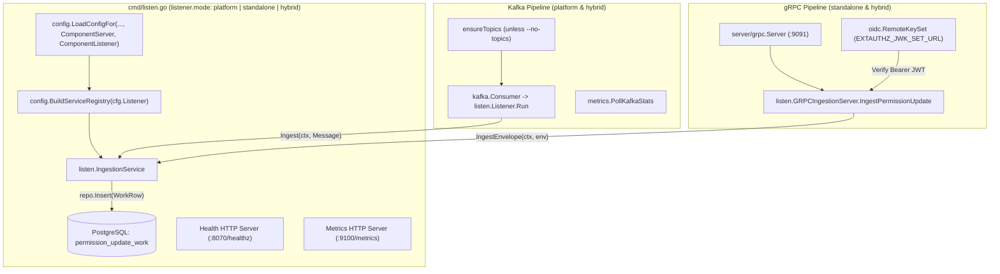

# Design

## Context

The `listen` command (`cmd/listen.go`) previously ran only a Kafka consumer loop (`internal/service/listen/listener.go`) and stored federated service registry properties (`federated_services`, `federated_services_strategy`) inside `KafkaConfig`. See `proposal.md` for motivation.

Supporting `platform`, `standalone`, and `hybrid` ingestion modes cleanly requires:
1. A dedicated `ListenerConfig` (`listener:` YAML section, symmetric to `worker:`) that owns `mode`, `federated_services_strategy`, and `federated_services`, so `Listener` does not depend on `KafkaConfig` when running in `standalone` mode.
2. Mode-aware validation via `ComponentListener` that validates `ListenerConfig` and conditionally delegates to `ComponentKafka` (for `platform` and `hybrid`) and `ComponentExtAuthz` (for `standalone` and `hybrid`).
3. A gRPC service (`PermissionIngestionService.IngestPermissionUpdate`) defined in `api/proto/v1/messages.proto` that accepts `PermissionUpdateEnvelope` directly.
4. Bearer JWT authentication against Ory Hydra's JWKS endpoint (`EXTAUTHZ_JWK_SET_URL`) for incoming gRPC ingestion requests, and transport-agnostic envelope persistence via `listen.IngestionService.IngestEnvelope`.

## Goals / Non-Goals

**Goals:**
- Introduce `ListenerConfig` (`listener:` in YAML) with `Mode` (`platform`, `standalone`, `hybrid`, default `platform`), `FederatedServicesStrategy` (`auto`, `fs`, `config`, default `auto`), and `FederatedServices`, removing federated service fields from `KafkaConfig`.
- Introduce `ComponentListener` in `config/specs.go` so `standalone` mode never requires or inspects `KafkaConfig`, `platform` mode does not require `ExtAuthzService`, and `platform`/`hybrid` modes enforce non-empty Kafka brokers and consumer group (with `kafka.enabled` and `worker.enabled` removed).
- Update `BuildServiceRegistry(cfg *ListenerConfig)` to accept `*ListenerConfig`.
- Define `PermissionIngestionService` in `api/proto/v1/messages.proto` and generate Go gRPC server and client stubs in `api/v1`.
- Implement `listen.IngestionService.IngestEnvelope` and `listen.GRPCIngestionServer` with Ory Hydra JWKS Bearer token verification (`codes.Unauthenticated` on failure).
- Register `PermissionIngestionServiceServer` on `server/grpc.Server` via `WithPermissionIngestionService` and supervise the active transports in `cmd/listen.go`.

**Non-Goals:**
- Modifying the `permission_update_work` PostgreSQL schema or introducing new migrations.
- Exposing `PermissionIngestionService` on `cmd/serve.go` or the REST gateway.
- Modifying `worker` or `serve` runtime behavior.

## Architecture & Data Flow



## Decisions

### Decision 1: Dedicated `ListenerConfig` (`listener:` YAML tree) & `ComponentListener` Validation
- **Choice**: Introduce `ListenerConfig` mapped to `listener:` in YAML (mirroring `worker:`):
  ```go
  type ListenerConfig struct {
      Mode                      string   `validate:"required,oneof=platform standalone hybrid" envconfig:"LISTENER_MODE" mapstructure:"mode" default:"platform"`
      FederatedServices         []string `validate:"" envconfig:"LISTENER_FEDERATED_SERVICES" mapstructure:"federated_services"`
      FederatedServicesStrategy string   `validate:"required,oneof=auto fs config" envconfig:"LISTENER_FEDERATED_SERVICES_STRATEGY" mapstructure:"federated_services_strategy" default:"auto"`
  }
  ```
  - Move `FederatedServices` and `FederatedServicesStrategy` out of `KafkaConfig` into `ListenerConfig`.
  - Bind environment variables with backward-compatible aliases in Viper:
    - `listener.mode` <- `LISTENER_MODE`, `LISTEN_MODE` (and `--mode` CLI flag)
    - `listener.federated_services_strategy` <- `LISTENER_FEDERATED_SERVICES_STRATEGY`, `FEDERATED_SERVICES_STRATEGY`, `KAFKA_FEDERATED_SERVICES_STRATEGY`
    - `listener.federated_services` <- `LISTENER_FEDERATED_SERVICES`, `FEDERATED_SERVICES`, `KAFKA_FEDERATED_SERVICES`
  - `ComponentListener` validation:
    1. Validates `c.Listener` struct (`Mode` and `FederatedServicesStrategy`), and if `c.Listener.FederatedServicesStrategy == "config"`, requires `len(c.Listener.FederatedServices) > 0`.
    2. When `c.Listener.Mode` is `platform` or `hybrid`: validates `c.Kafka` struct and requires non-empty `c.Kafka.Brokers` and `c.Kafka.ConsumerGroup`.
    3. When `c.Listener.Mode` is `standalone` or `hybrid`: delegates to `componentValidators[ComponentExtAuthz](c)` so `c.ExtAuthzService.JwkSetURL` is validated as `required,http_url`.
- **Rationale**:
  - The listener component in `standalone` mode has zero dependency on `KafkaConfig` (`c.Kafka` can be `nil` or omitted).
  - Mirrors the existing `worker:` YAML configuration section, providing a dedicated namespace for listener-level settings (`mode`, `federated_services_strategy`, `federated_services`).
  - `topics list` (`cmd/list_topics.go`) now validates only `ComponentListener` without needing `ComponentKafka`, while `topics ensure` (`cmd/ensure_topics.go`) validates both `ComponentListener` and `ComponentKafka`.
- **Alternatives Considered**:
  - *Keeping `FederatedServices` in `KafkaConfig` and `Mode` in `ServerConfig`*: Rejected because it forces the listener in `standalone` mode to depend on `KafkaConfig` for service federation and pollutes `ServerConfig` with listener-specific state.

### Decision 2: Direct `PermissionUpdateEnvelope` RPC in `api/proto/v1/messages.proto`
- **Choice**: Define `PermissionIngestionService` in `api/proto/v1/messages.proto`:
  ```protobuf
  service PermissionIngestionService {
    rpc IngestPermissionUpdate(PermissionUpdateEnvelope) returns (IngestPermissionUpdateResponse);
  }

  message IngestPermissionUpdateResponse {}
  ```
- **Rationale**:
  - Callers send `PermissionUpdateEnvelope` directly without an extra wrapper message layer, and `IngestPermissionUpdateResponse` allows future non-breaking response fields.

### Decision 3: Shared `IngestionService.IngestEnvelope` and Provenance Defaults
- **Choice**: Add `IngestEnvelope(ctx context.Context, env *messagesv1.PermissionUpdateEnvelope) error` to `listen.IngestionService` (and the `listen.EnvelopeIngestor` seam).
  - Resolves whether `env.GetService()` is a registered federated service via `s.registry.HasService(slug)`, validates the envelope via `s.validator.Validate(env, slug)`, marshals `env` to protobuf bytes for `WorkRow.Payload`, and inserts the row with `Partition: 0, Offset: 0`.
- **Rationale**:
  - Reuses the exact same validation, database persistence, duplicate suppression (`repository.ErrDuplicate`), logging, and Prometheus metrics across both Kafka and gRPC transports.

### Decision 4: Ory Hydra JWKS Bearer Authentication on the gRPC Handler
- **Choice**: Implement `listen.GRPCIngestionServer` accepting `authz.OidcVerifier` and `EnvelopeIngestor`.
  - Extracts incoming gRPC `authorization: Bearer <token>` metadata and verifies the JWT via `verifier.Verify(ctx, token)` (`codes.Unauthenticated` on failure, `codes.InvalidArgument` on permanent validation error, `codes.Internal` on transient DB error).

## Database Schema Modifications

None.

## Cross-Cutting Considerations

- **Security**: Every `IngestPermissionUpdate` call is authenticated against Ory Hydra's JWKS (`EXTAUTHZ_JWK_SET_URL`) before reading or persisting the envelope.
- **Performance & Scalability**: `oidc.RemoteKeySet` caches JWKS keys in memory. Both Kafka and gRPC ingestion paths are stateless and scale horizontally.
- **Observability**: gRPC requests are instrumented by `server/grpc`'s request-ID, structured logging, panic recovery, and Prometheus unary server interceptors, as well as `listen.Metrics`.
- **Migration & Rollout**: `ListenerConfig.Mode` defaults to `platform` and legacy `FEDERATED_SERVICES*` / `KAFKA_FEDERATED_SERVICES*` env vars remain bound as aliases, ensuring zero breaking changes for existing deployments.

## Risks / Trade-offs

- **[Risk]** Existing scripts or deployments setting `FEDERATED_SERVICES` or `KAFKA_FEDERATED_SERVICES` via environment variables.
  → **Mitigation**: Bind `LISTENER_FEDERATED_SERVICES`, `FEDERATED_SERVICES`, and `KAFKA_FEDERATED_SERVICES` (and the corresponding `*_STRATEGY` vars) to `listener.federated_services*` in `config/viper.go`.
