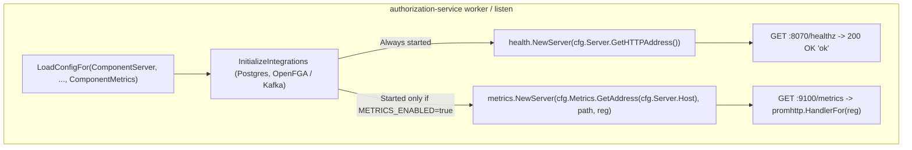

## Context

`authorization-service` runs three long-running runtime modes:
1. `authorization-service serve`: Runs the gRPC server (`SERVER_GRPC_PORT`, default `9091`), REST gateway (`HTTP_PORT` / `SERVER_HTTP_PORT`, default `8070`, which exposes `/healthz`), and an optional Prometheus metrics HTTP server (`METRICS_PORT`, default `9100`).
2. `authorization-service worker`: Claims permission-update rows from PostgreSQL and applies tuple changes to OpenFGA, alongside an optional in-process stale-row reaper and an optional Prometheus metrics HTTP server (`METRICS_PORT`, default `9100`).
3. `authorization-service listen`: Consumes permission-update events from Kafka and persists them to PostgreSQL, alongside a Kafka stats poller and an optional Prometheus metrics HTTP server (`METRICS_PORT`, default `9100`).

Currently, `worker` and `listen` only start the `internal/metrics` server when `cfg.Metrics.Enabled` is `true`, and neither component exposes `GET /healthz`. Coupling health checks into `internal/metrics` (for example, calling `metrics.NewServer` with a `nil` registry when metrics are disabled) would blur domain boundaries and confuse maintainers. Instead, health checking should be provided by a dedicated `internal/health` package that binds to `cfg.Server.GetHTTPAddress()` (`<SERVER_HOST>:<HTTP_PORT>`, default `0.0.0.0:8070`, matching `serve`), while `internal/metrics` remains untouched on `METRICS_PORT` (`9100`).

## Goals / Non-Goals

### Goals
- Introduce a standalone `internal/health` package with `health.NewServer(addr string) *http.Server` serving `GET /healthz` (`200 OK`, `text/plain; charset=utf-8`, body `ok`).
- Always start the health HTTP server on `cfg.Server.GetHTTPAddress()` (`<SERVER_HOST>:<HTTP_PORT>`, default `0.0.0.0:8070`) in `cmd/worker.go` and `cmd/listen.go`, regardless of `METRICS_ENABLED`.
- Keep `internal/metrics` completely unchanged and decoupled from health checking.
- Validate `config.ComponentServer` in `cmd/worker.go` and `cmd/listen.go` so `HTTP_PORT` and `SERVER_HOST` are validated at startup, and ensure the supervision loop in both commands gracefully shuts down `healthServer` and `metricsServer` and drains all remaining component goroutines even when a component exits with an error.

### Non-Goals
- Modifying `internal/metrics/http.go` or coupling `/healthz` to `METRICS_PORT` / `METRICS_ENABLED`.
- Modifying `server/rest/gateway.go`, `server/grpc/server.go`, or `cmd/serve.go`'s REST/gRPC health check mechanisms.
- Performing active downstream dependency queries (PostgreSQL, OpenFGA, Kafka) inside the `/healthz` handler.
- Adding HTTP servers to short-lived CLI commands (`migrate`, `seed`, `reaper`, `ensure-topics`, `list-topics`, `authz`).

## Architecture & Component Lifecycle



```mermaid
sequenceDiagram
    participant Main as cmd/worker.go or cmd/listen.go
    participant Loop as Worker / Listener Loop
    participant Health as Health HTTP Server (:8070)
    participant Metrics as Metrics HTTP Server (:9100, optional)
    participant Probe as Orchestrator (K8s / Pebble)

    Main->>Health: ListenAndServe() (goroutine)
    opt METRICS_ENABLED=true
        Main->>Metrics: ListenAndServe() (goroutine)
    end
    Main->>Loop: Run(ctx) (goroutine)
    Probe->>Health: GET /healthz
    Health-->>Probe: 200 OK (text/plain: "ok")
    Note over Main,Health: On SIGINT/SIGTERM or component error
    Main->>Loop: cancel() context
    Main->>Health: Shutdown(shutdownCtx)
    Health-->>Main: nil (http.ErrServerClosed)
    opt METRICS_ENABLED=true
        Main->>Metrics: Shutdown(shutdownCtx)
        Metrics-->>Main: nil (http.ErrServerClosed)
    end
    Loop-->>Main: nil (drain remaining components)
```

## Key Design Decisions

### Decision 1: Dedicated `internal/health` Package Bound to `cfg.Server.GetHTTPAddress()` (`HTTP_PORT`, default `8070`)
- **Choice**: Create `internal/health` (`internal/health/http.go`) exporting `NewServer(addr string) *http.Server`, which registers `GET /healthz` on a dedicated `http.ServeMux`. In `cmd/worker.go` and `cmd/listen.go`, include `config.ComponentServer` in `config.LoadConfigFor(...)` and always start `health.NewServer(cfg.Server.GetHTTPAddress())` alongside the existing optional `metrics.NewServer(...)`.
- **Rationale**:
  - Preserves clean domain boundaries: `internal/health` owns health check HTTP serving, and `internal/metrics` owns Prometheus metrics serving. Neither package knows about the other.
  - Consistency across all runtime deployments (`serve`, `worker`, `listen`): every component exposes `GET /healthz` on `HTTP_PORT` (default `8070`, configurable via `HTTP_PORT`, `SERVER_HTTP_PORT`, or `--http-port`) and Prometheus metrics on `METRICS_PORT` (default `9100`) when `METRICS_ENABLED=true`.
  - `cmd/worker.go` and `cmd/listen.go` already reference `cfg.Server.Host` and `cfg.Server.GracefulShutdownTimeout`, `config/viper.go` already sets valid defaults for `ServerConfig` (`grpc_port: 9091`, `http_port: 8070`, `host: "0.0.0.0"`, `shutdown_timeout: 15s`), and `cmd/root.go` already defines `--http-port` and `--server-host` as persistent flags inherited by all subcommands.
- **Alternatives Considered**:
  1. *Mount `/healthz` inside `internal/metrics.NewServer` on `METRICS_PORT` (`9100`) and pass a `nil` registry when metrics are disabled*: Rejected because invoking a `metrics` package with a `nil` registry solely to run a health check server leaks domain boundaries and confuses future maintainers.
  2. *Introduce a separate `HealthConfig` (`HEALTH_PORT`) in `config/specs.go`*: Rejected because `ServerConfig.HTTPPort` (`HTTP_PORT` / `--http-port`, default `8070`) already exists for the component's HTTP port and matches `serve`.

### Decision 2: Plain-Text `ok` Response Format & Method Restriction
- **Choice**: Register `mux.HandleFunc("GET /healthz", ...)` (using Go 1.22+ method-pattern routing in `net/http.ServeMux`, which automatically handles `GET` and `HEAD` and returns `405 Method Not Allowed` for other methods) that sets `Content-Type: text/plain; charset=utf-8`, writes `http.StatusOK`, and writes `"ok"`.
- **Rationale**:
  - Standard Go `net/http` pattern routing (`"GET /healthz"`) enforces HTTP method semantics cleanly with zero external dependencies.
  - Plain-text `ok` is minimal, fast, and requires no JSON serialization overhead, while leaving `server/rest/gateway.go` untouched.
- **Alternatives Considered**:
  1. *JSON `{"status":"SERVING"}` response*: Rejected to keep `worker` and `listen` health checks minimal (`ok`) without modifying `server/rest/gateway.go`.

### Decision 3: Liveness-Style Process Health Check vs. Deep Dependency Polling
- **Choice**: The `/healthz` handler returns `200 OK` as long as the component has completed startup initialization (`InitializeIntegrations`, including PostgreSQL connection pool creation and OpenFGA/Kafka setup) and the health HTTP server is running prior to shutdown.
- **Rationale**:
  - Both `worker` and `listen` verify configuration and initialize integrations before starting the health HTTP server, and if the main worker or listener loop exits with an error, the command cancels context and shuts down the health server immediately.
  - Executing database or OpenFGA queries on every probe request adds load and can cause cascading pod restarts during transient downstream latency spikes.
- **Alternatives Considered**:
  1. *Active `db.Ping` / OpenFGA / Kafka broker checks on each `GET /healthz`*: Rejected because transient network blips would fail liveness probes and trigger unnecessary container restarts even though the worker and listener have built-in retry/backoff loops.

### Decision 4: Race-Free Supervision & Graceful Shutdown in `cmd/worker.go` and `cmd/listen.go`
- **Choice**: In `runWorker` and `runListen`, track `remaining := numComponents` and `var firstErr error`. When `case res := <-errChan:` fires in `select`, decrement `remaining--`, record `firstErr` if `res.err != nil` (without returning early), and call `cancel()`. Then unconditionally shut down `healthServer` (and `metricsServer` if non-nil) using `cfg.Server.GracefulShutdownTimeout`, drain the remaining `remaining` results from `errChan`, and return `firstErr` if set.
- **Rationale**:
  - Previously, `runWorker` and `runListen` returned immediately when `res.err != nil` in `select`, skipping `http.Server.Shutdown()` and allowing `defer integrations.CleanupIntegrations(logger)` to close Postgres/Kafka while background goroutines were still running. Additionally, when `res.err == nil`, draining `numComponents` items after already consuming 1 item in `select` would deadlock waiting for a `(numComponents + 1)`-th result.
  - Fixing the drain counter and always shutting down the HTTP servers guarantees clean, deadlock-free, and race-free termination whether shutdown is triggered by `SIGINT`/`SIGTERM`, a worker/listener error, or an HTTP port bind error.

## Database Schema Modifications

None. This change does not modify any PostgreSQL tables, indexes, or migrations.

## Cross-Cutting Considerations

- **Security**: The `/healthz` endpoint exposes only a static `"ok"` status string and leaks no internal state, credentials, or version details.
- **Performance**: Handler execution is allocation-minimal (writing a 2-byte constant response) and does not contend on locks or external I/O.
- **Observability**: Startup and shutdown of the health HTTP server are logged via `slog` (`Starting health server`, `address`, `healthServer.Addr`). Prometheus metrics on `:9100/metrics` remain completely unchanged.
- **Scalability**: Stateless in-process HTTP handler with zero impact on horizontal scaling of `worker` or `listen` instances.
- **Migration & Rollout**: Container orchestrators (Kubernetes, Juju Pebble, Docker Compose) can configure identical health probe settings (`GET /healthz` on `HTTP_PORT`, default `8070`) across `serve`, `worker`, and `listen`. When running multiple components on the same host without network namespace isolation (e.g., local bare-metal processes in `LOCAL_DEVELOPMENT.md`), operators can pass `--http-port` or `HTTP_PORT` per process.
