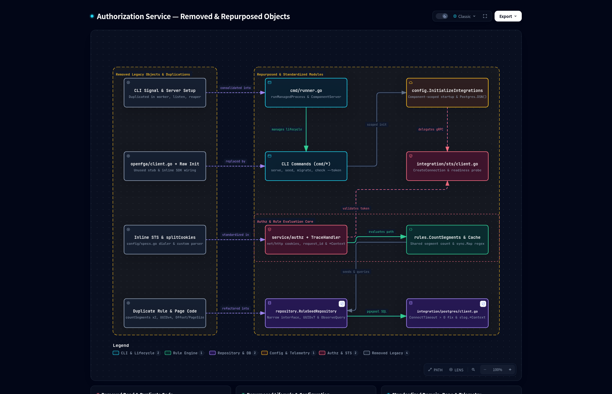
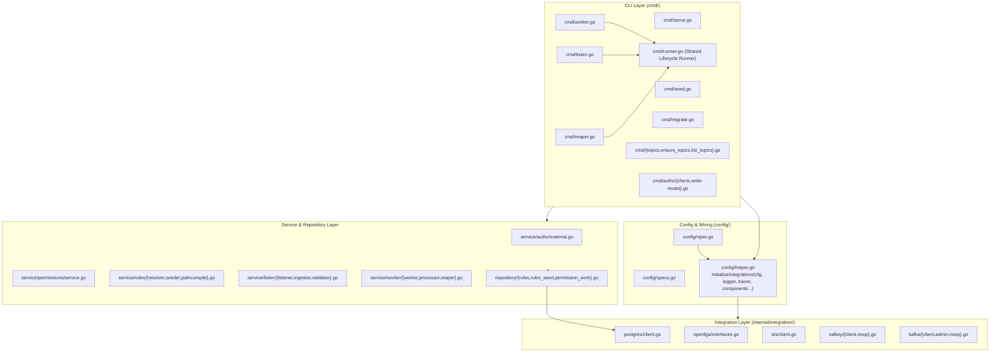

# Design

## Context

`authorization-service` provides multiple CLI subcommands (`serve`, `listen`, `worker`, `reaper`, `seed`, `migrate`, `topics ensure`, `topics list`, `authz check`, and `authz write-model`). Each subcommand validates only its required configuration components through `config.LoadConfigFor`. However, client initialization, process lifecycle management, regex compilation, and structured logging still differ across packages. See [proposal.md](./proposal.md) for the problem statement and [specs/command-config-validation/spec.md](./specs/command-config-validation/spec.md) for the updated specifications.

## Goals / Non-Goals

**Goals:**
- Initialize only the external clients that each CLI command requests in `config.InitializeIntegrations`.
- Share signal handling, Prometheus metrics server startup and shutdown, and OpenTelemetry tracer shutdown in `cmd/runner.go`.
- Fix the `ConnectTimeout` check in `postgres.NewClient`, the missing `tracerShutdown` call in `authz check`, and repeated regex compilation in `internal/service/rules`.
- Delete unused code in `internal/integration/openfga/client.go`, `internal/service/permissions/noop.go`, `internal/integration/postgres/client.go`, and `config/specs.go`.
- Standardize repository interfaces, UUIDv7 generation, query metrics, and context-aware `slog` calls.

**Non-Goals:**
- Database schema modifications: This change does not add or modify any database tables, indexes, SQL queries, or migrations.
- External API modifications: This change does not modify gRPC services, REST endpoints, Envoy `ext_authz` responses, or Prometheus metric names.

## Decisions

### 1. Component-Scoped `InitializeIntegrations`
- **Decision**: Update `InitializeIntegrations(cfg *Config, logger *slog.Logger, tracer trace.Tracer, components ...Component)` to accept a variadic list of `Component` values. When the caller provides `components`, the function initializes only the matching integrations (`ComponentOpenFGA`, `ComponentOpenFGAModelWriter`, `ComponentValkey`, `ComponentPostgres`, `ComponentKafka`, and `ComponentSTS`). Unrequested Valkey and Kafka clients use `valkey.NewNoopClient` and `kafka.NewNoopConsumer`. Other unrequested clients remain `nil`. When `components` is empty, the function initializes all non-nil configuration sections to keep backward compatibility with existing tests.
- **Trade-offs and Alternatives**:
  - *Alternative 1 — Register Viper defaults only for requested components*: Rejected. Viper registers defaults before unmarshaling, and partial defaults break full configuration inspection.
  - *Alternative 2 — Create separate initialization functions per command*: Rejected. A single component-scoped function keeps `Integrations.Close()` in one place.

### 2. Shared CLI Process Runner (`cmd/runner.go`)
- **Decision**: Create a runner in `cmd/runner.go` that performs three tasks:
  1. Starts the Prometheus metrics `*http.Server` when `cfg.Metrics.Enabled` is `true`.
  2. Runs one or more named component functions `func(ctx context.Context) error` in background goroutines.
  3. Waits for `SIGINT`, `SIGTERM`, or the first component exit, cancels the context, stops the metrics server within `cfg.Server.GracefulShutdownTimeout`, and waits for all component goroutines to finish.
- **Trade-offs and Alternatives**:
  - *Alternative — Use `golang.org/x/sync/errgroup` or `oklog/run`*: Rejected. Standard library channels and `context.WithCancel` preserve the exact logging and shutdown timeout behavior of `cmd/worker.go` and `cmd/listen.go` without new dependencies.

### 3. Compiled Regex Cache in `RuleMatcher` and `ResourceMapper`
- **Decision**: Store compiled `*regexp.Regexp` instances in a `sync.Map` keyed by `PathRegex` string inside `internal/service/rules`. Both `RuleMatcher.Match` and `extractRegexMatches` read from this cache.
- **Performance and Scalability**: PostgreSQL stores a bounded set of seeded route rules. Previously, each `Check` call compiled every candidate rule regex and compiled the matched rule regex a second time. Caching compiled regular expressions reduces regex compilation cost from $O(N + 1)$ per request to $O(1)$ after the first match while keeping `RuleMatcherInterface` and `ResourceMapperInterface` signatures unchanged.
- **Trade-offs and Alternatives**:
  - *Alternative — Change `RuleMatcherInterface.Match` to return extracted capture groups*: Rejected. Changing the interface signature breaks `RuleMatcherInterface` and generated mocks.

### 4. Separation of Config Structs from STS Client Dialing
- **Decision**: Move gRPC connection dialing and readiness polling (`CreateConnection` and `waitForConnectionReady`) from `config/specs.go` to `internal/integration/sts/client.go`. Keep a delegating `CreateSTSConnection` method on `STSConfig` for existing tests. Remove unused `envconfig` and `default` struct tags from `config/specs.go`.
- **Rationale**: This change places STS connection logic in `internal/integration/sts` alongside `postgres`, `valkey`, and `kafka`, and keeps `config/viper.go` as the single source of default values.

### 5. Context-Aware Structured Logging and `TraceHandler`
- **Decision**: Update `logging.TraceHandler.Handle` to read `request_id` from `ctx` via `logging.RequestIDFromContext(ctx)` when the log record does not already contain `request_id`. Replace `slog.Debug`, `slog.Info`, `slog.Warn`, and `slog.Error` calls with `DebugContext`, `InfoContext`, `WarnContext`, and `ErrorContext` in `internal/service/*`, `internal/integration/*`, `config/specs.go`, `server/rest/gateway.go`, and `cmd/*` whenever `ctx` is available.
- **Observability and Security**: Every log record written during a request or background job includes `trace_id`, `span_id`, and `request_id` for correlation in Grafana and Tempo. No tokens, cookies, or secrets are added to log attributes.

### 6. `RuleSeeder` Interface and Repository Standardization
- **Decision**: Define `RuleSeedRepository` in `internal/repository/rules.go` and pass it to `rules.NewRuleSeeder`. Replace `uuid.New()` with `uuid.NewV7()` in `internal/repository/rules_seed.go`. Record query duration and error metrics with `r.metrics.ObserveQuery` in `GetCurrentRevision`, `UpsertFederatedService`, and `ReplaceServiceRules`.
- **Rationale**: This matches the interface design, UUIDv7 identifiers, and Prometheus query metrics used in `PostgresPermissionWorkRepository` and `PostgresRuleRepository.FindCandidates`.

## Risks / Trade-offs

- **[Risk] Regex cache memory growth if callers pass unbounded dynamic patterns** → **Mitigation**: Only seeded `authorization_rule.path_regex` values enter the cache. This set is small and bounded by the rule configuration file.
- **[Risk] Duplicate `request_id` attributes on log records** → **Mitigation**: `TraceHandler` checks existing log record attributes before adding `request_id`.
- **[Risk] Migration and CLI script compatibility** → **Mitigation**: Keep `--dsn` on `migrate` as the first priority before falling back to `cfg.Postgres.DSN()`. Keep `--cookie` on `authz check` alongside the new `--token` flag.
