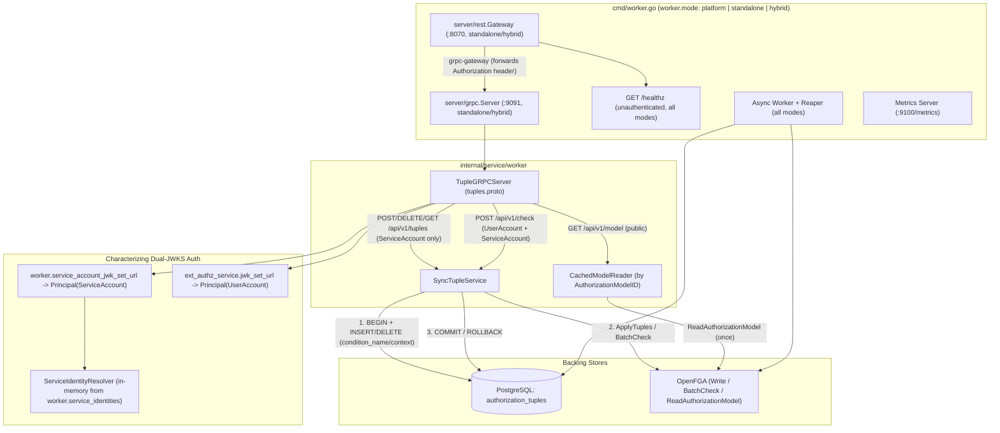

# Design

## Context

`authorization-service worker` (`cmd/worker.go`) currently runs the asynchronous work-queue loop (`worker.Worker`), the in-process stale-row reaper (`worker.Reaper`, optional via `--no-reaper`), the HTTP health server (`internal/health.NewServer` serving `GET /healthz` on `:8070`), and the optional Prometheus metrics server (`:9100/metrics`). It already owns `PostgresPermissionWorkRepository` and `worker.OpenFGAApplier`.

The repository already maintains a protobuf + `grpc-gateway` + OpenAPI v2/v3 code generation pipeline (`buf.yaml`, `buf.gen.yaml`, `Makefile` `protogen` and `openapi-v3`, `openapi/api.swagger.json`, `openapi/api.yaml`), as well as reusable `server/grpc.Server` and `server/rest.Gateway` servers. See `proposal.md` for motivation and scope.

## Goals / Non-Goals

**Goals:**
- Define the new synchronous tuple management, check proxy, and model inspection APIs in a new protobuf file `api/proto/v1/tuples.proto` without breaking existing `.proto` definitions or OpenAPI generation.
- Expose the APIs on `worker` in `standalone` and `hybrid` modes over **both** gRPC (`server/grpc.Server`, `:9091`) and HTTP REST (`server/rest.Gateway`, `:8070`, preserving unauthenticated `GET /healthz`), while keeping `platform` mode unchanged.
- Characterize authenticated callers into a typed in-memory `Principal` (`UserAccount` via `ext_authz_service.jwk_set_url` vs `ServiceAccount` via `worker.service_account_jwk_set_url`), requiring both JWKS URLs in `standalone` and `hybrid` modes.
- Enforce batch limits of **50** items on `POST /api/v1/tuples`, `DELETE /api/v1/tuples`, and `POST /api/v1/check`.
- Persist OpenFGA condition metadata (`condition_name TEXT`, `condition_context JSONB`) in `authorization_tuples` on both sync (`jwt.org`) and async (`worker.Processor`) writes when `multitenancyEnabled=true`.
- Serve `GET /api/v1/model` publicly from an in-memory cache in both JSON (default) and indented `text/plain` DSL (`?format=dsl`).

**Non-Goals:**
- Implementing `ListObjects` or `ListUsers`.
- Accepting caller-supplied `condition` fields on `POST /api/v1/tuples`.
- Creating a `service_auth_identities` table or modifying `cmd/serve.go` / `cmd/listen.go`.

## Architecture & Data Flow



## Decisions

### Decision 1: Protobuf Definition (`api/proto/v1/tuples.proto`) & Dual gRPC + `grpc-gateway` Exposure
- **Choice**: Create `api/proto/v1/tuples.proto` in `package authorization.service.api.v1` with `option go_package = "github.com/canonical/authorization-service/api/proto/v1";` defining `TupleService`:
  - `WriteTuples(WriteTuplesRequest) returns (WriteTuplesResponse)` -> `POST /api/v1/tuples`, `body: "*"`
  - `DeleteTuples(DeleteTuplesRequest) returns (DeleteTuplesResponse)` -> `DELETE /api/v1/tuples`, `body: "*"`
  - `ListTuples(ListTuplesRequest) returns (ListTuplesResponse)` -> `GET /api/v1/tuples`
  - `Check(CheckRequest) returns (CheckResponse)` -> `POST /api/v1/check`, `body: "*"`
  - `GetAuthorizationModel(GetAuthorizationModelRequest) returns (google.api.HttpBody)` -> `GET /api/v1/model`
- **Rationale**:
  - Using `google.api.HttpBody` (from `google/api/httpbody.proto`, already available via `buf.build/googleapis/googleapis`) for `GetAuthorizationModel` lets `grpc-gateway` return `Content-Type: application/json` (for `format=json`/default) AND raw, properly indented `Content-Type: text/plain; charset=utf-8` (for `format=dsl`) natively without custom HTTP marshalers or breaking OpenAPI generation.
  - `buf generate api/proto` (`make protogen`) automatically generates `api/v1/tuples.pb.go`, `api/v1/tuples_grpc.pb.go`, `api/v1/tuples.pb.gw.go`, and merges into `openapi/api.swagger.json` (`allow_merge=true`), and `make openapi-v3` updates `openapi/api.yaml` without touching existing `.proto` files.
  - Extend `server/rest.Gateway` with an optional handler registrar (`WithHandlerRegistrar(func(ctx context.Context, mux *runtime.ServeMux, conn *grpc.ClientConn) error)`) and `server/grpc.Server` with `WithTupleService(...)` so `cmd/serve.go` remains untouched while `cmd/worker.go` wires both servers in `standalone`/`hybrid` modes.
- **Alternatives Considered**:
  - *Hand-written `net/http` handlers*: Rejected because it would not expose gRPC endpoints or auto-generate OpenAPI/Swagger specs.

### Decision 2: Characterizing Dual-JWKS Config & Typed `Principal` (`UserAccount` vs `ServiceAccount`)
- **Choice**:
  - Extend `WorkerConfig` (`config/specs.go`):
    ```go
    type AuthType string
    const AuthTypeOIDC AuthType = "OIDC"

    type ServiceIdentity struct {
        AuthType    AuthType `validate:"required,oneof=OIDC" mapstructure:"auth_type" json:"auth_type"`
        Identifier  string   `validate:"required" mapstructure:"identifier" json:"identifier"`
        ServiceSlug string   `validate:"required" mapstructure:"service_slug" json:"service_slug"`
    }

    type WorkerConfig struct {
        Mode                    string            `validate:"required,oneof=platform standalone hybrid" envconfig:"WORKER_MODE" mapstructure:"mode" default:"platform"`
        ServiceAccountJwkSetURL string            `validate:"omitempty,http_url" envconfig:"WORKER_SERVICE_ACCOUNT_JWK_SET_URL" mapstructure:"service_account_jwk_set_url"`
        ServiceIdentities       []ServiceIdentity `validate:"dive" envconfig:"WORKER_SERVICE_IDENTITIES" mapstructure:"service_identities"`
        // ...existing fields unchanged...
    }
    ```
  - In `ComponentWorker` validation when `mode` is `standalone` or `hybrid`:
    - Require `ext_authz_service.jwk_set_url` (`UserAccount` / STS JWKS) via `componentValidators[ComponentExtAuthz](c)`.
    - Require `worker.service_account_jwk_set_url` (`ServiceAccount` / external OIDC JWKS) to be non-empty and a valid HTTP URL.
    - Validate `worker.service_identities` (`auth_type == OIDC`, non-empty `identifier` and `service_slug`, no duplicate `(auth_type, identifier)`).
  - Define an in-memory `Principal` in `internal/service/worker/principal.go`:
    ```go
    type PrincipalType string

    const (
        PrincipalTypeUserAccount    PrincipalType = "UserAccount"
        PrincipalTypeServiceAccount PrincipalType = "ServiceAccount"
    )

    type Principal struct {
        Type       PrincipalType
        Identifier string // client_id (fallback sub) for ServiceAccount; sub for UserAccount
        Org        string // JWT org claim (used when multitenancyEnabled=true)
    }
    ```
  - `DualJWKSAuthenticator` verifies the incoming Bearer JWT against `serviceAccountVerifier` first (yielding `PrincipalTypeServiceAccount`) and, on failure, against `userAccountVerifier` (yielding `PrincipalTypeUserAccount`). Both failing -> `codes.Unauthenticated` (`401`).
  - Endpoint authorization matrix:
    - `GetAuthorizationModel`: public (no JWT required).
    - `Check`: any valid `Principal` (`UserAccount` or `ServiceAccount`).
    - `WriteTuples`, `DeleteTuples`, `ListTuples`: `PrincipalTypeServiceAccount` only (`UserAccount` -> `codes.PermissionDenied` / `403`), and `ServiceIdentityResolver.Resolve(ctx, AuthTypeOIDC, principal.Identifier)` must succeed (unmapped -> `codes.PermissionDenied` / `403`).
- **Rationale**: Cryptographically separates `UserAccount` (STS) from `ServiceAccount` (external OIDC) without guessing from claims and without colliding on `EXT_AUTHZ_SERVICE_JWK_SET_URL` in shared ConfigMaps (`terraform/authorization-service.tf`).

### Decision 3: Transactional PG + OpenFGA Coordination, Batch Cap (50), and Multitenancy
- **Choice**:
  - Cap `WriteTuples`, `DeleteTuples`, and `Check` at **50** items per request (`<= 0` or `> 50` -> `codes.InvalidArgument` / `400`).
  - `WriteTuples` / `DeleteTuples`:
    1. Validate all tuples via shared helpers in `internal/model/permissions`.
    2. When `multitenancyEnabled=true` on `WriteTuples`: require non-empty `principal.Org` (else `codes.Unauthenticated` / `401`) and build `Condition{Name: "tenant_match", Context: {"tenant": principal.Org}}` for both OpenFGA and `authorization_tuples`.
    3. Open PG transaction -> stage idempotent `INSERT ... ON CONFLICT DO NOTHING` (including `condition_name`, `condition_context`) or `DELETE` on `authorization_tuples` -> call `TupleApplier.ApplyTuples` with `OpenFGA.Timeout` -> on OpenFGA error: rollback PG and return `InvalidArgument` (permanent) or `Unavailable` (transient) -> commit PG.
    4. If `tx.Commit` fails after OpenFGA succeeded: return `codes.Internal` (`500`) with explicit guidance instructing the caller to retry the idempotent request.
  - Also update `worker.Processor` (`toModelTuples` -> `RecordProcessed`) so async writes persist `condition_name` and `condition_context` into `authorization_tuples` when `multitenancyEnabled=true`.
  - `Check`:
    1. Validate 1..50 items, unique non-empty `correlation_id`, valid tuple syntax.
    2. When `multitenancyEnabled=true`, require non-empty `principal.Org` (else `codes.Unauthenticated` / `401`).
    3. Inject `{"tenant_enabled": multitenancyEnabled, "user_tenant": principal.Org}` into each `client.ClientBatchCheckItem.Context` and invoke `fga.BatchCheck` with `OpenFGA.Timeout`.

### Decision 4: Cached OpenFGA Model Inspection (`GET /api/v1/model`)
- **Choice**: `CachedModelReader` fetches `cfg.OpenFGA.AuthorizationModelID` once via `fga.ReadAuthorizationModel` (guarded by `sync.Mutex` / double-checked cache so transient startup errors can be retried on the next call, while successful fetches are cached for process lifetime because OpenFGA model IDs are immutable).
  - `format=""` or `format="json"`: returns marshaled OpenFGA `AuthorizationModel` JSON with `Content-Type: application/json`.
  - `format="dsl"`: transforms the cached JSON using `github.com/openfga/language/pkg/go/transformer.TransformJSONStringToDSL` (already in `go.mod`, properly indented) and caches the resulting DSL string, returning `Content-Type: text/plain; charset=utf-8`.
  - Any other `format`: `codes.InvalidArgument` (`400`).

## Database Schema Modifications

New migration `migrations/00004_add_authorization_tuples_conditions_and_indexes.sql`:

```sql
-- +goose Up
-- +goose StatementBegin
ALTER TABLE authorization_tuples
    ADD COLUMN condition_name    TEXT,
    ADD COLUMN condition_context JSONB,
    ADD CONSTRAINT chk_authorization_tuples_condition_name_required
        CHECK (condition_context IS NULL OR condition_name IS NOT NULL);

CREATE INDEX idx_authorization_tuples_service_id
    ON authorization_tuples (service, id);

CREATE INDEX idx_authorization_tuples_service_object
    ON authorization_tuples (service, object);
-- +goose StatementEnd

-- +goose Down
-- +goose StatementBegin
DROP INDEX IF EXISTS idx_authorization_tuples_service_object;
DROP INDEX IF EXISTS idx_authorization_tuples_service_id;

ALTER TABLE authorization_tuples
    DROP CONSTRAINT IF EXISTS chk_authorization_tuples_condition_name_required,
    DROP COLUMN IF EXISTS condition_context,
    DROP COLUMN IF EXISTS condition_name;
-- +goose StatementEnd
```

- `authorization_tuples.service` remains `TEXT NOT NULL` without a foreign key constraint.

## Cross-Cutting Considerations

- **Security**: Characterizing dual-JWKS verification guarantees `UserAccount` tokens can never mutate or list `authorization_tuples`, and `ServiceAccount` tokens are strictly scoped to their configured `service_slug`. Raw JWTs are never logged. `GET /api/v1/model` is cached in memory to prevent DoS against OpenFGA.
- **Performance & Scalability**: `oidc.RemoteKeySet` caches JWKS keys; `StaticServiceIdentityResolver` is O(1) in-memory; `CachedModelReader` avoids repeated OpenFGA model reads; `OpenFGA.Timeout` + batch cap of 50 bound PG transaction duration; `(service, id)` and `(service, object)` indexes support fast service-scoped pagination and object filtering.
- **Observability**: Reuses `server/grpc` interceptors (request-ID, logging, recovery, gRPC Prometheus metrics) and `server/rest` middleware (request-ID bridging, logging, REST Prometheus metrics), plus dedicated sync-tuple operation metrics.
- **Migration & Rollout**: Additive, backward-compatible migration and `worker.mode` default (`platform`).

## Risks / Trade-offs

- **[Risk] Post-OpenFGA PostgreSQL commit failure**: Network/DB failure between OpenFGA `Write` and `tx.Commit` leaves OpenFGA ahead of `authorization_tuples`.
  → **Mitigation**: Return `codes.Internal` (`500`) instructing the caller to retry; idempotency on both stores reconciles state safely.
- **[Risk] Same JWKS URL configured for both `ext_authz_service.jwk_set_url` and `worker.service_account_jwk_set_url` in dev/test**: Deterministic verification order (`serviceAccountVerifier` first) ensures predictable behavior, while production deployments use distinct STS and OIDC provider JWKS URLs.
- **[Risk] `DELETE /api/v1/tuples` with JSON body via `grpc-gateway`**: Supported by `google.api.http` (`delete: "/api/v1/tuples"`, `body: "*"`) and tested explicitly in both unit and integration tests.
